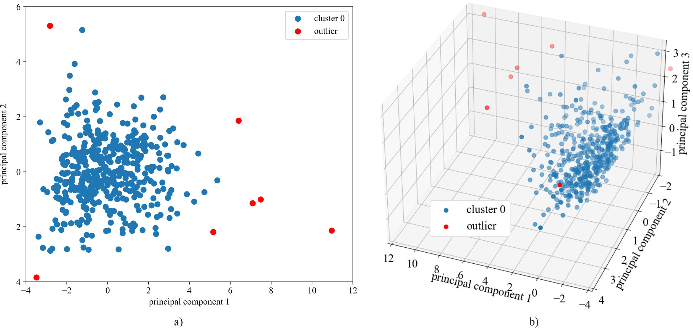

# A Study of Online Melt Pool, Plume, and Spatter Tracking in  Laser Powder Bed Fusion using DBSCAN

This repo accompanies the paper: Yanzhou Fu, Matthew Whetham, Austin R. J. Downey, Lang Yuan, and Gurcan Comert. A study of online melt pool, plume, and spatter tracking in laser powder bed fusion using DBSCAN. In Christopher Niezrecki and Saman Farhangdoust, editors, Digital Twins, AI, and NDE for Industry Applications and Energy Systems 2025, page 21. SPIE, May 2025. doi:10.1117/12.3051110.

The melt pool, plume, and spatter features are extracted from the printing images.

The 2D and 3D visualization of the clustering results from DBSCAN.

## Code
The code 'unsupervised learning DBSCAN_v2.py' implements DBSCAN with 2D visualization.

The Code 'unsupervised learning DBSCAN_3D.py' implements DBSCAN with 3D visualization.

# Data
The data folder contains only a portion of the printing images due to GitHub's document size limitation. For access to the full dataset, please contact the authors.

## Licensing and Citation

[![CC BY-SA 4.0][cc-by-sa-shield]][cc-by-sa]

This work is licensed under a
[Creative Commons Attribution-ShareAlike 4.0 International License][cc-by-sa].

[cc-by-sa]: http://creativecommons.org/licenses/by-sa/4.0/
[cc-by-sa-image]: https://licensebuttons.net/l/by-sa/4.0/88x31.png
[cc-by-sa-shield]: https://img.shields.io/badge/License-CC%20BY--SA%204.0-lightgrey.svg

Cite as:

@Misc{Fu2025PaperStudyOnline,   
  author = {Yanzhou Fu and Austin R.J. Downey},   
  howpublished = {GitHub},  
  title  = {Paper-2025-A-Study-of-Online-Melt-Pool-Plume-and-Spatter-Tracking-in-Laser-Powder-Bed-Fusion-using-DBSCAN},   
  year   = {2025},  
  groups = {{ARTS-L}ab},    
  url    = {https://github.com/ARTS-Laboratory/Paper-2025-A-Study-of-Online-Melt-Pool-Plume-and-Spatter-Tracking-in-Laser-Powder-Bed-Fusion},    
}
